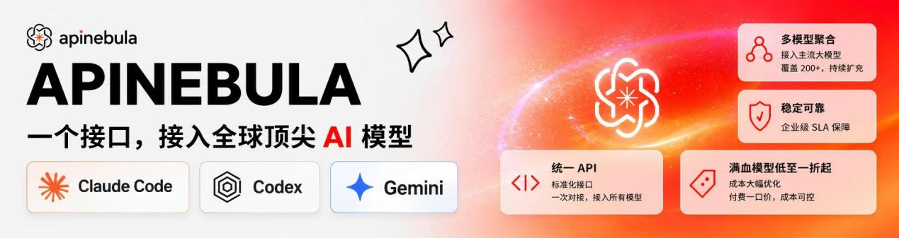
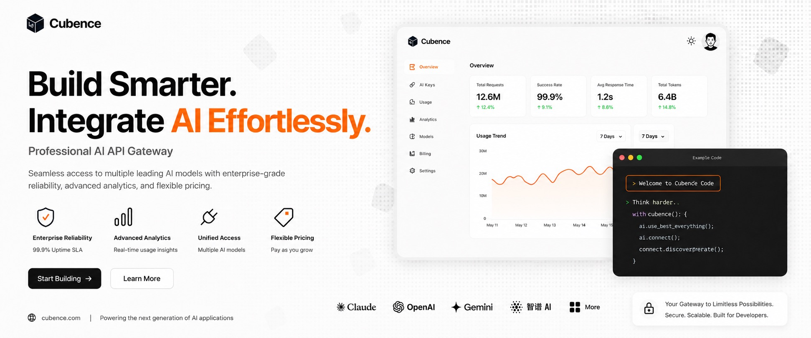
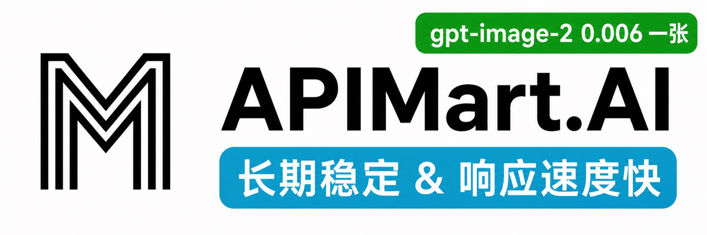
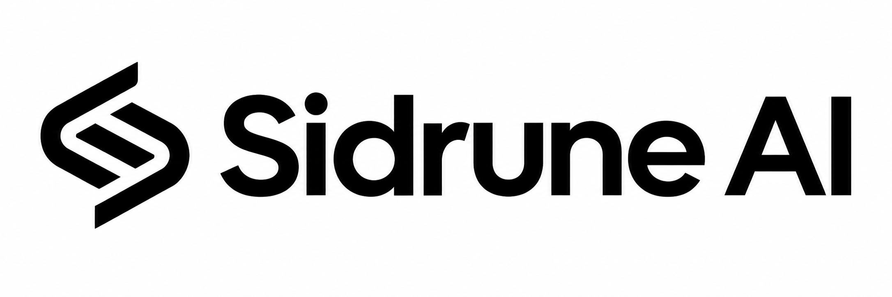
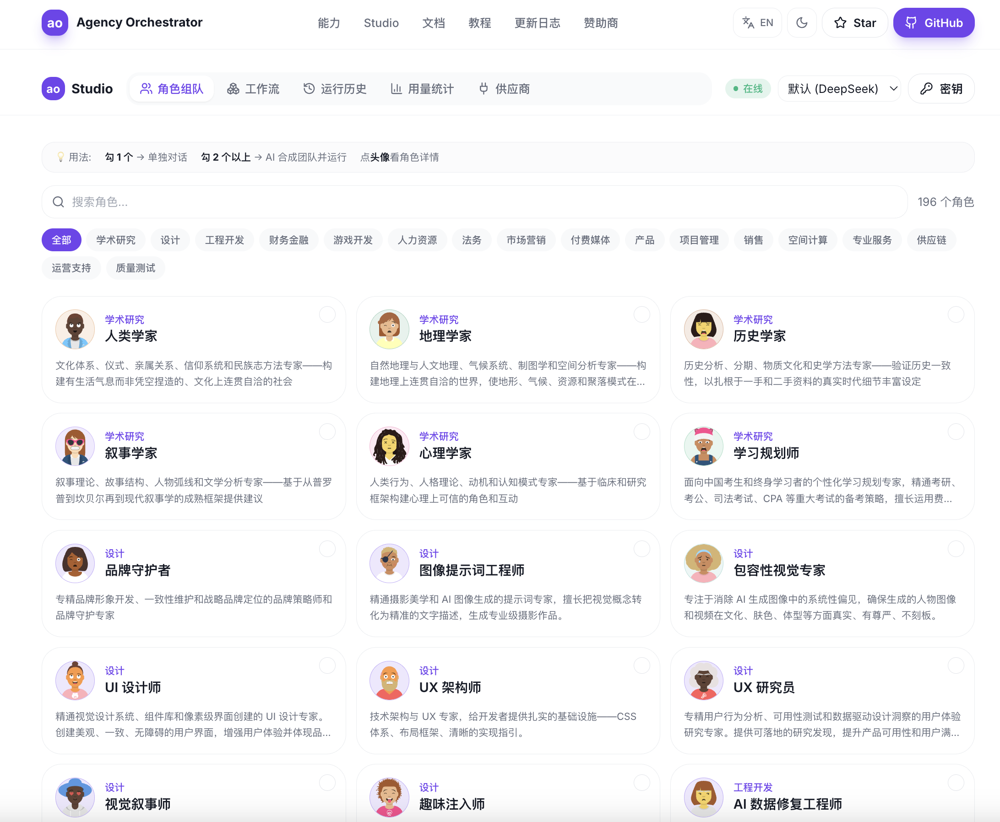

# agency-agents 中文版（AI 智能体专家团队）

🌐 **简体中文** | [繁體中文](README.zh-TW.md) | [English (upstream)](https://github.com/msitarzewski/agency-agents)

> **328 个即插即用的 AI 专家角色** — 覆盖公司经营（CEO/CTO/CMO/COO/CPO/CFO）、工程、设计、营销、产品、游戏、安全、GIS、金融等 22 个部门。不是通用提示词模板，每个智能体都有独立的人设、专业流程和可交付成果。支持 Claude Code / Cursor / Copilot 等 20 种 AI 编程工具。

[agency-agents](https://github.com/msitarzewski/agency-agents) 的中文社区版。在已有上游翻译的基础上，新增了 67 个中国市场原创智能体（小红书、抖音、微信、B站、飞书、钉钉等平台运营，以及跨境电商、政务ToG、医疗合规、Qt 工业上位机、机械设计、畜禽养殖档案核对等垂直领域）。

想更好地用起来，或想给团队打造统一的智能体工作台？[下载桌面客户端](https://github.com/jnMetaCode/agency-orchestrator/releases/latest)（原生 App，免装 Node，macOS / Windows / Linux），或在线体验 [ao.aiolaola.com/experts](https://ao.aiolaola.com/experts)。

[](https://github.com/jnMetaCode/agency-agents-zh)
[](https://opensource.org/licenses/MIT)
[](https://makeapullrequest.com)
[](https://www.npmjs.com/package/agency-agents-zh)
[](https://github.com/jnMetaCode/agency-orchestrator/releases/latest)
[](https://ao.aiolaola.com/experts)


> 🧠 **新：让 Claude Code / Codex / Cursor / Gemini CLI 不再失忆** → [engram](https://github.com/jnMetaCode/engram)：一条 `npx @jnmetacode/engram install`，自动记住每次会话问过什么、改了哪些文件、最后怎么解决的，下次开会话自动带回（带出处）。**记忆跨工具共享**——Codex 里定的事，Claude Code 也知道。全本地、零依赖、中文友好。

### 📊 项目规模

| 🤖 AI 智能体 | 🌏 英文版翻译 | 🇨🇳 中国市场原创 | 🧠 支持工具 | 🏢 部门 |
|:---:|:---:|:---:|:---:|:---:|
| **328** | **261** | **67** | **20 种** | **22 个** |

> 📖 **官方配套课程** → [AI 专家团队实战](https://aiolaola.com/course/ai-agency?utm_source=github&utm_campaign=agents)（35 节，免费）：手把手把这仓 328 位专家用成一支团队——单兵点名、自动组队、一人公司全流程，桌面端零代码教学。另有 [从零学会 AI 编程](https://aiolaola.com/?utm_source=github&utm_campaign=agents)（182 节）＋ [从零构建 AI 智能体](https://aiolaola.com/course/ai-agent?utm_source=github&utm_campaign=agents)（40 节）（站上共 14 门课、700 节，**全部 ¥0**——另有 大模型原理 / AI 绘画 / 写小说 / 漫剧 / 量化 / DeepSeek / 深度专注 等）
>
> 🌍 Also available in [English](https://aiolaola.com/en?utm_source=github&utm_campaign=agents) · [日本語](https://aiolaola.com/ja?utm_source=github&utm_campaign=agents) · [Español](https://aiolaola.com/es?utm_source=github&utm_campaign=agents) · [한국어](https://aiolaola.com/ko?utm_source=github&utm_campaign=agents) · [繁體中文](https://aiolaola.com/zh-Hant?utm_source=github&utm_campaign=agents)

---

## 🙏 赞助商 &nbsp;<sub>想出现在这里？联系 [jnMetaCode@qq.com](mailto:jnMetaCode@qq.com)</sub>

<p align="center">
  <a href="https://apinebula.ai/V6ekjG">
    
  </a>
</p>

感谢 [APINEBULA](https://apinebula.ai/V6ekjG) 大屏赞助本项目！APINEBULA 是银河录像局旗下的企业级 AI 聚合平台，背靠大平台资源，面向开发者、团队与企业用户提供稳定、高性价比的大模型 API 接入服务。平台聚合 Claude、GPT、Gemini 等主流满血模型，一个接口接入全球顶尖 AI 大模型，各大模型价格低至 1 折起，支持企业级高并发、正式合同、对公打款与开票服务，适合 AI 编程、Agent 开发、业务系统集成等多种场景！

🎁 **通过[此链接](https://apinebula.ai/V6ekjG)注册并在充值时填写 "agent" 优惠码可享九折优惠！**

<hr>

<table>
<tr>
<td width="25%">
  <a href="https://cubence.com/signup?code=SCW29JP9">
    
  </a>
</td>
<td width="75%" valign="middle">

感谢 [Cubence](https://cubence.com/signup?code=SCW29JP9) 对本项目的支持。Cubence 是一家致力为客户提供稳定、高效的 API 中转服务商。从 25 年 9 月运营至今，提供了 Claude Code、Codex、Gemini 等多种模型支持。🎁 **通过[此链接](https://cubence.com/signup?code=SCW29JP9)注册的用户，首次购买时填写专属优惠码 `AGENCY` 即可享受 9 折优惠！**

</td>
</tr>
</table>

<table>
<tr>
<td width="25%">
  <a href="https://lanox.ai/?c=X3RD38F7&inviteCode=A3HRUB6M">
    
  </a>
</td>
<td width="75%" valign="middle">

感谢 [LanoX AI](https://lanox.ai/?c=X3RD38F7&inviteCode=A3HRUB6M) 赞助了本项目！LanoX AI 为开发者、团队与企业提供稳定、高性价比的全球模型接入服务，覆盖 GPT、Claude、Gemini、Qwen、Grok 等主流模型，以及 Seedance 2.0、GPT Image、Gemini Nano Banana 等多模态创作能力。高可用、原生能力输出、不降智、不混模、调用与计费透明，顶级模型低至官方价 1 折起，文档清晰、接入简单，支持开票与企业批量调用，适用于 AI 产品、Agent、内容平台与研发团队。🎁 **通过[此链接](https://lanox.ai/?c=X3RD38F7&inviteCode=A3HRUB6M)注册的用户，可获赠 5 美金体验额度与百万免费 Token，另有 500+ 免费模型可用！**

</td>
</tr>
</table>

<table>
<tr>
<td width="25%">
  <a href="https://www.shengsuanyun.com/?from=CH_QKH696UI">
    
  </a>
</td>
<td width="75%" valign="middle">

感谢[胜算云](https://www.shengsuanyun.com/?from=CH_QKH696UI)对本项目的赞助！胜算云是面向 AI 原生团队的模型 API 聚合平台，汇集 Claude、ChatGPT、Gemini 等海内外大语言模型及多媒体模型，支持统一接入与按量调用。平台坚持合规 API 服务，杜绝逆向工程和资源稀释。此外平台提供企业级定制网关，包括团队成本与权限管理、智能路由、安全防护及 BYOK 密钥托管，并提供发票服务。🎁 **新用户通过[此链接](https://www.shengsuanyun.com/?from=CH_QKH696UI)注册，即可领取 5 元 Token 体验额度！**

</td>
</tr>
</table>

<table>
<tr>
<td width="25%">
  <a href="https://go.apimart.ai/gh-agency-agents-zh">
    
  </a>
</td>
<td width="75%" valign="middle">

感谢 [APIMart](https://go.apimart.ai/gh-agency-agents-zh) 赞助了本项目！APIMart 是专注 AI 图片/视频生成的低价 API 平台，GPT-Image-2 低至 $0.006/张，1 美元可出图 160+ 张。图片、视频共用一套异步 API，提交任务拿 ID、轮询或回调取结果，跑批万张不超时、换模型不改代码。按量付费、无月费。🎁 **通过[此链接](https://go.apimart.ai/gh-agency-agents-zh)注册即可开用！**

</td>
</tr>
</table>

<table>
<tr>
<td width="25%">
  <a href="https://www.packyapi.ai/register?aff=Zpx1">
    
  </a>
</td>
<td width="75%" valign="middle">

感谢 [PackyCode](https://www.packyapi.ai/register?aff=Zpx1) 赞助了本项目！PackyCode 是一家稳定、高效的 API 中转服务商，一句话接入主流大模型。统一域名、统一密钥、智能容灾切换，97% 可用性。人民币 1:1 充值，无汇率、无手续费坑，多分组折扣低至 2 折起，提供专属 Codex / Claude Code 高速通道。支持 Stripe、支付宝、微信、银行卡、对公付款，对公付款可开票。🎁 **新用户通过[此链接](https://www.packyapi.ai/register?aff=Zpx1)注册，首充立享折扣，另赠 $1 免费体验额度！**

</td>
</tr>
</table>

<table>
<tr>
<td width="25%">
  <a href="https://sidrune.ai/register?source=github&campaign=agencyagents&promo=agencyagents&aff=RQHWKAMQLX2S">
    
  </a>
</td>
<td width="75%" valign="middle">

感谢 [Sidrune AI](https://sidrune.ai/register?source=github&campaign=agencyagents&promo=agencyagents&aff=RQHWKAMQLX2S) 赞助本项目！**一个入口，接入并管理全球主流 AI 模型。** Sidrune AI 面向个人开发者、技术团队与企业，通过统一 API 接入并管理全球主流 AI 模型；通过多线路动态调度提升可用性，模型表现、响应时间与费用透明可查。根据不同模型与线路，API 调用成本较官方或基准价格可降低 40%—98%。🎁 **通过[此链接](https://sidrune.ai/register?source=github&campaign=agencyagents&promo=agencyagents&aff=RQHWKAMQLX2S)注册，即可获得 $3 API 额度！**

</td>
</tr>
</table>

<table>
<tr>
<td width="25%" align="center" valign="middle">
  <a href="https://www.ucloud.cn/site/active/astraflow-credit?ytag=geo_waituo_agencyagentszh">
    
    <br><br>
    <strong>星图&nbsp;AstraFlow</strong>
  </a>
</td>
<td width="75%" valign="middle">

感谢 [星图 AstraFlow](https://www.ucloud.cn/site/active/astraflow-credit?ytag=geo_waituo_agencyagentszh) 赞助本项目！星图 AstraFlow 由 UCloud 上市公司出品，聚合 MiniMax-H3、Seedance-2.5 等主流视频生成模型，文案生成与视频生成一个平台全搞定，无需多端注册、多处对接。支持 DeepSeek V4.1、Kimi K3、Qwen 3.8 Max、GLM 5.3、GPT-6、Claude 等 200+ 主流大模型，新模型上线当天即可接入。按 Key 级别计费，调用明细全程可查，费用透明可控。🎁 **新用户通过[专属链接](https://www.ucloud.cn/site/active/astraflow-credit?ytag=geo_waituo_agencyagentszh)注册，即可领取 50 元算力金，开箱即用！**

</td>
</tr>
</table>

---

## 🚀 让角色库跑起来 · Agency Orchestrator

> 一句话，让多个 AI 专家自动组队协作，几分钟交付完整方案。

```bash
npm install -g agency-orchestrator
ao compose "帮我写一篇关于 AI Agent 的深度分析文章" --run
```

**不想用命令行？** [**下载桌面客户端**](https://github.com/jnMetaCode/agency-orchestrator/releases/latest)（原生 App，免装 Node，macOS / Windows / Linux），或在线体验 [ao.aiolaola.com/experts](https://ao.aiolaola.com/experts)。

零代码编排 · DAG 并行 · 断点续跑 · 10 种大模型（7 种免 key）· 现成模板开箱即用 —— [**了解 Agency Orchestrator →**](https://github.com/jnMetaCode/agency-orchestrator)

---

## 🖼️ 在线浏览全部专家（无需安装）

搜索 / 按部门筛选 / 查看与**复制每位专家的完整提示词**，直接在浏览器里看（线上收录数量以页面为准）：

<p align="center">
  <a href="https://ao.aiolaola.com/experts">
    <br/>
    <strong>🔗 在线专家库 ao.aiolaola.com/experts →</strong>
  </a>
</p>

---

## 这是什么？

一套**开箱即用的 AI 角色库**。每个智能体都有明确的身份定义、关键规则、工作流程和交付物，安装到你的 AI 编程工具后用自然语言激活。

**和普通提示词的区别**：普通提示词告诉 AI "你是一个专家"；这里的智能体定义了专家**怎么思考、怎么做事、交付什么**。例如[安全工程师](engineering/engineering-security-engineer.md)会按 OWASP Top 10 逐项审查代码，[小红书运营专家](marketing/marketing-xiaohongshu-operator.md)会输出完整的种草笔记策略和达人合作方案。

---

## 快速开始

### 方式一：一键安装到你的 AI 工具

支持 **20 种主流 AI 编程工具**，一条命令搞定：

```bash
# 自动检测已安装的工具，一键安装
./scripts/install.sh

# 或指定安装到特定工具
./scripts/install.sh --tool openclaw       # OpenClaw ⭐ 推荐
./scripts/install.sh --tool claude-code    # Claude Code
./scripts/install.sh --tool copilot        # GitHub Copilot
./scripts/install.sh --tool cursor         # Cursor
./scripts/install.sh --tool kiro           # Kiro (Amazon)
./scripts/install.sh --tool trae           # Trae
./scripts/install.sh --tool opencode       # OpenCode
./scripts/install.sh --tool aider          # Aider
./scripts/install.sh --tool windsurf       # Windsurf
./scripts/install.sh --tool antigravity    # Antigravity
./scripts/install.sh --tool gemini-cli     # Gemini CLI
./scripts/install.sh --tool qwen           # Qwen Code
./scripts/install.sh --tool zcode          # ZCode (智谱)
./scripts/install.sh --tool qwenpaw        # QwenPaw (阿里)
./scripts/install.sh --tool codex          # Codex CLI
./scripts/install.sh --tool deerflow       # DeerFlow 2.0 (ByteDance)
./scripts/install.sh --tool workbuddy      # WorkBuddy (Tencent)
./scripts/install.sh --tool codewhale      # CodeWhale (原 DeepSeek-TUI)
./scripts/install.sh --tool hermes         # Hermes Agent (NousResearch)
./scripts/install.sh --tool qoder          # Qoder
```

> Claude Code 和 GitHub Copilot 可直接安装；其他工具需先运行 `./scripts/convert.sh` 转换格式。

### 🔥 OpenClaw 用户快速上手

OpenClaw 是目前社区用户最多的集成方式，每个智能体会拆分为三个文件：`SOUL.md`（身份人设）+ `AGENTS.md`（业务能力）+ `IDENTITY.md`（简介），天然支持多智能体协作编排。

```bash
./scripts/convert.sh --tool openclaw   # 第一步：转换为 SOUL.md 格式
./scripts/install.sh --tool openclaw   # 第二步：安装到 ~/.openclaw/
```

安装后重启 OpenClaw 网关即可使用。

### 方式二：手动复制

```bash
# Claude Code / GitHub Copilot（直接复制即可）
cp -r marketing/*.md ~/.claude/agents/

# 在 Claude Code 中激活：
# "激活前端开发者模式，帮我构建一个 React 组件"
```

### 方式三：作为提示词参考

浏览下方智能体列表，复制/改编你需要的内容！

---

### 方式四：通过 npm 获取角色库

```bash
npm install agency-agents-zh
```

角色文件位于 `node_modules/agency-agents-zh/`，可直接读取或复制对应 Markdown。安装 Agency Orchestrator 后，也可指定这个目录：

```bash
ao roles --agents-dir ./node_modules/agency-agents-zh
```

npm 包提供角色内容，不会自动修改你的 AI 工具配置。上面的 `install.sh` / `convert.sh` 安装流程需要克隆 GitHub 仓库后执行。

## 智能体阵容

### 🏢 公司经营部

一个人的公司也有高管层——定方向、做取舍、对结果负责。

| 智能体 | 专长 | 适用场景 |
|--------|------|----------|
| [首席执行官 CEO](company/chief-executive-officer.md) ⭐ | 战略方向、资源配置、组织节奏、对外叙事 | 定方向、做重大取舍、把愿景翻成优先级 |
| [首席技术官 CTO](company/chief-technology-officer.md) ⭐ | 技术路线、架构决策、研发组织、技术债 | 选型评审、技术债取舍、研发效能 |
| [首席产品官 CPO](company/chief-product-officer.md) ⭐ | 产品战略、路线图取舍、产品组织 | 需求裁决、路线图排期、产品复盘 |
| [首席营销官 CMO](company/chief-marketing-officer.md) ⭐ | 定位、渠道组合、营销预算、品牌资产 | 增长打法、预算分配、品牌建设 |
| [首席运营官 COO](company/chief-operating-officer.md) ⭐ | 流程、指标、执行节奏 | 把战略落成 SOP、消灭组织摩擦 |
| [首席财务官 CFO](company/chief-financial-officer.md) | 资本配置、资金运营、财务规划、投资者关系 | 融资、预算、董事会汇报 |
| [幕僚长](company/chief-of-staff.md) | 战略运营、跨部门协调、OKR 追踪 | 高管例会、组织变革推进 |

> 想开一次"高管例会"？把这几位放进同一个工作流，让他们分别从战略/技术/产品/增长/运营/财务视角过同一个议题——这正是 [Agency Orchestrator](https://github.com/jnMetaCode/agency-orchestrator) 的用法。

### 🛠️ 工程部

构建未来，一个 commit 一个脚印。

| 智能体 | 专长 | 适用场景 |
|--------|------|----------|
| [前端开发者](engineering/engineering-frontend-developer.md) | React/Vue、UI 实现、性能优化 | 现代 Web 应用、像素级 UI |
| [后端架构师](engineering/engineering-backend-architect.md) | API 设计、数据库架构、可扩展性 | 服务端系统、微服务 |
| [AI 工程师](engineering/engineering-ai-engineer.md) | 机器学习、模型部署、AI 集成 | ML 功能、数据管线 |
| [DevOps 自动化师](engineering/engineering-devops-automator.md) | CI/CD、基础设施自动化 | 流水线开发、部署自动化 |
| [安全工程师](engineering/engineering-security-engineer.md) | 威胁建模、代码审计、安全架构 | 应用安全、漏洞评估 |
| [快速原型师](engineering/engineering-rapid-prototyper.md) | 快速 POC、MVP 开发 | 概念验证、黑客马拉松 |
| [高级开发者](engineering/engineering-senior-developer.md) | Laravel/Livewire/FluxUI、高端 CSS、Three.js | 高品质 Web 体验 |
| [移动应用开发者](engineering/engineering-mobile-app-builder.md) | iOS/Android 原生、跨平台框架 | 移动端开发、App 性能优化 |
| [数据工程师](engineering/engineering-data-engineer.md) | ETL/ELT、数据湖、Spark/dbt | 数据管线、数据仓库 |
| [技术文档工程师](engineering/engineering-technical-writer.md) | API 文档、开发者文档、docs-as-code | 技术文档、知识库 |
| [自主优化架构师](engineering/engineering-autonomous-optimization-architect.md) | 自适应系统、自动调优 | 智能运维、自愈系统 |
| [桌面应用工程师](engineering/engineering-desktop-app-engineer.md) | Electron/Tauri、安全 IPC、签名公证、自动更新 | 桌面客户端开发与发布 |
| [API 平台工程师](engineering/engineering-api-platform-engineer.md) | OpenAPI/gRPC、版本与弃用、SDK 生成、限流 | 公开 API、合作方 API 与开发者门户 |
| [数据库可靠性工程师](engineering/engineering-database-reliability-engineer.md) | 高可用、备份恢复、零停机迁移、灾备演练 | 数据库运维与灾备 |
| [平台工程师](engineering/engineering-platform-engineer.md) | 黄金路径、自助式基础设施、Backstage | 内部开发者平台、研发效能 |
| [开发者工具工程师](engineering/engineering-developer-tooling-engineer.md) | CLI 设计、错误信息、启动速度、shell 补全 | 内部 CLI、开发者工具链 |
| [FinOps 工程师](engineering/engineering-finops-engineer.md) | 成本分摊、规格调整、预留实例/节省计划 | 云成本治理与优化 |
| [隐私工程师](engineering/engineering-privacy-engineer.md) | PII 发现、同意执行、被遗忘权、假名化 | 隐私合规落地、数据删除 |
| [国际化工程师](engineering/engineering-i18n-engineer.md) | ICU、CLDR 复数、RTL 布局、伪本地化 | 多语言产品、出海国际化 |
| [知识图谱工程师](engineering/engineering-knowledge-graph-engineer.md) | Neo4j、实体抽取、溯源、GraphRAG | 知识库构建、降低幻觉 |
| [搜索相关性工程师](engineering/engineering-search-relevance-engineer.md) | ES/OpenSearch、BM25 调优、混合检索、nDCG | 站内搜索、商品搜索优化 |
| [LLM 后训练工程师](engineering/engineering-llm-post-training-engineer.md) | SFT/DPO/GRPO、故障诊断、检查点完整性 | 模型微调与对齐、训练事故排查 |
| [实时协作工程师](engineering/engineering-realtime-collaboration-engineer.md) | CRDT/OT、可安全重连协议、在线状态 | 协同文档、实时多人应用 |
| [WebAssembly 工程师](engineering/engineering-webassembly-engineer.md) | Wasm、WASI、wasm-bindgen、体积优化 | 浏览器高性能计算、插件沙箱 |
| [视频流媒体工程师](engineering/engineering-video-streaming-engineer.md) | ffmpeg、HLS/DASH/CMAF、DRM、ABR | 点播/直播平台、视频分发降本 |
| [移动端发布工程师](engineering/engineering-mobile-release-engineer.md) | 代码签名、fastlane、分阶段发布、商店提审 | App 上架与版本发布 |
| [数据可视化工程师](engineering/engineering-data-visualization-engineer.md) | D3/Vega/ECharts、配色、大数据量渲染 | 数据仪表盘、报表图表 |
| [IoT 设备群工程师](engineering/engineering-iot-fleet-engineer.md) | OTA 放量与回滚、设备身份、MQTT 遥测 | 大规模设备运维、固件升级 |
| [Rust 重构专家](engineering/engineering-rust-refactoring-specialist.md) | 仓库级重构、所有权、Clippy、SemVer | Rust 代码库治理与迁移 |
| [PDF 引擎架构师](engineering/engineering-pdf-engine-architect.md) | HTML 转 PDF、Playwright、PDF/A、矢量完整性 | 简历/合同/报表生成 |
| [通用文档编译器](engineering/engineering-universal-document-compiler.md) | 文档 AST、布局推断、YAML 双向同步 | 任意数据生成简历/报告/方案 |
| [ATS 校验架构师](engineering/engineering-ats-validator-architect.md) | ATS 解析、BM25、X-Y-Z 评分、AI 招聘合规 | 海外求职简历优化、招聘系统 |
| [网络工程师](engineering/engineering-network-engineer.md) | Cisco/Juniper/Palo Alto、BGP/OSPF、变更回滚 | 国外厂商设备的企业网运维 |
| [GaussDB 专家](engineering/engineering-gaussdb-expert.md) | 分布键、CN/DN 执行计划、UStore、国密 | 信创数据库选型与调优 |
| [Drupal 性能工程师](engineering/engineering-drupal-performance.md) | 缓存标签/上下文、BigPipe、Views 优化 | Drupal 站点提速 |
| [WordPress 性能工程师](engineering/engineering-wordpress-performance.md) | 对象缓存、WP_Query、Core Web Vitals | WordPress/WooCommerce 站点提速 |
| [Section 508 无障碍专家](engineering/engineering-section-508-specialist.md) | Section 508/ADA、屏幕阅读器测试、VPAT | 美国政府与企业网站无障碍合规 |
| [ServiceNow 开发导师](engineering/engineering-servicenow-developer-mentor.md) | Business Rule、GlideAggregate、ACL 排障 | ServiceNow 平台开发与运维 |
| [USWDS 开发工程师](engineering/engineering-uswds-developer.md) | 设计令牌、官方组件、联邦设计语言 | 美国联邦/公共部门网站 |
| [RAG 管线工程师](engineering/engineering-rag-pipeline-engineer.md) | 文档切分、混合检索、重排与检索质量评测 | 知识库问答、证据检索 |
| [身份与访问工程师](engineering/engineering-identity-access-engineer.md) | OAuth/OIDC、SSO、SCIM、会话与多租户授权 | 登录系统、企业身份与权限隔离 |
| [支付与计费工程师](engineering/engineering-payments-billing-engineer.md) | 幂等支付、可靠回调、订阅计费与对账 | 支付接入、订阅和退款 |
| [嵌入式算法工程师](engineering/engineering-embedded-algorithm-engineer.md) ⭐ | DSP、传感器融合、定点化、TinyML | 算法移植、精度与板端资源验证 |
| [嵌入式应用工程师](engineering/engineering-embedded-application-engineer.md) ⭐ | RTOS/Linux 应用、状态机、设备协议、恢复 | 设备业务开发、整机联调与升级恢复 |
| [嵌入式固件工程师](engineering/engineering-embedded-firmware-engineer.md) | RTOS、外设驱动、低功耗设计 | IoT、嵌入式系统 |
| [上位机工程师](engineering/engineering-pc-host-engineer.md) ⭐ | Qt/QML、QSerialPort、Modbus/CAN、QChart 实时可视化 | 工业上位机、检测设备、HMI |
| [机械设计工程师](engineering/engineering-mechanical-design-engineer.md) ⭐ | 传动选型、强度刚度疲劳振动校核、DFMA、GB/ISO 标准件 | 工业装备、自动化产线、检测仪器 |
| [嵌入式 Linux 驱动工程师](engineering/engineering-embedded-linux-driver-engineer.md) ⭐ | 内核模块、设备树、Platform/I2C/SPI 驱动 | 嵌入式 Linux BSP 开发 |
| [FPGA/ASIC 数字设计工程师](engineering/engineering-fpga-digital-design-engineer.md) ⭐ | Verilog/SystemVerilog、时序收敛、AXI 总线 | FPGA 开发、数字逻辑设计 |
| [IoT 方案架构师](engineering/engineering-iot-solution-architect.md) ⭐ | MQTT/CoAP、边缘计算、设备管理、云平台 | 物联网端到端方案设计 |
| [国内网络工程师](engineering/engineering-network-engineer-china.md) ⭐ | 华为 VRP/华三 Comware/锐捷、VLAN/OSPF/BGP/VXLAN、信创国产化、等保组网 | 国产设备园区网/数据中心/广域网 |
| [故障响应指挥官](engineering/engineering-incident-response-commander.md) | 故障处置、SLO 管理、事后复盘 | 线上故障、应急响应 |
| [威胁检测工程师（工程侧）](engineering/engineering-threat-detection-engineer.md) | SIEM、威胁狩猎、检测规则 | 安全运营、威胁检测 |
| [Solidity 智能合约工程师](engineering/engineering-solidity-smart-contract-engineer.md) | Solidity、EVM、Gas 优化、DeFi | 智能合约开发、Web3 |
| [微信小程序开发者](engineering/engineering-wechat-mini-program-developer.md) ⭐ | WXML/WXSS、微信支付、云开发 | 微信小程序全栈开发 |
| [代码审查员](engineering/engineering-code-reviewer.md) | 代码审查、安全审计、质量把关 | PR 审查、代码质量 |
| [数据库优化师](engineering/engineering-database-optimizer.md) | Schema 设计、查询优化、索引策略 | 数据库性能调优 |
| [Git 工作流大师](engineering/engineering-git-workflow-master.md) | 分支策略、约定式提交、变基 | Git 工作流规范 |
| [软件架构师](engineering/engineering-software-architect.md) | 系统设计、DDD、架构决策 | 系统架构设计 |
| [SRE (站点可靠性工程师)](engineering/engineering-sre.md) | SLO、可观测性、混沌工程 | 站点可靠性工程 |
| [AI 数据修复工程师](engineering/engineering-ai-data-remediation-engineer.md) | 自愈管道、SLM 语义聚类、零数据丢失 | 大规模数据异常修复 |
| [飞书集成开发工程师](engineering/engineering-feishu-integration-developer.md) ⭐ | 飞书机器人、审批流、多维表格 | 飞书生态集成开发 |
| [钉钉集成开发工程师](engineering/engineering-dingtalk-integration-developer.md) ⭐ | 钉钉机器人、酷应用、连接器 | 钉钉生态集成开发 |
| [CMS 开发者](engineering/engineering-cms-developer.md) | Drupal/WordPress、主题开发、自定义插件 | CMS 站点开发与内容架构 |
| [邮件智能工程师](engineering/engineering-email-intelligence-engineer.md) | 邮件解析、结构化提取、AI 推理数据 | 智能体邮件集成 |
| [Filament 优化专家](engineering/engineering-filament-optimization-specialist.md) | Filament PHP 后台重构、高影响力改造 | PHP 后台管理优化 |
| [代码库入职引导工程师](engineering/engineering-codebase-onboarding-engineer.md) | 读源码、追踪调用路径、只讲代码事实 | 新人上手陌生代码库 |
| [最小变更工程师](engineering/engineering-minimal-change-engineer.md) | 最小可行差异、拒绝范围蔓延 | Bug 修复、需要小而稳的 PR |
| [多智能体系统架构师](engineering/engineering-multi-agent-systems-architect.md) | 多智能体拓扑、上下文管理、人工审核关卡 | 生产级多智能体系统设计 |
| [Prompt 工程师](engineering/engineering-prompt-engineer.md) | 提示词打磨、测试与系统化优化 | 把 AI 功能做到可上线 |
| [语音 AI 集成工程师](engineering/engineering-voice-ai-integration-engineer.md) | Whisper、云端 ASR、说话人分离、字幕生成 | 音视频转录与字幕流水线 |
| [IT 服务经理](engineering/engineering-it-service-manager.md) | ITIL 4、事件/问题/变更管理、SLA、CMDB | 企业 IT 服务管理 |
| [OrgScript 工程师](engineering/engineering-orgscript-engineer.md) | OrgScript 语法、解析器、AST 校验 | 用 OrgScript 定义业务逻辑 |
| [WordPress 购物车工程师](engineering/engineering-wordpress-shopping-cart.md) | WooCommerce、支付网关、checkout 定制 | WordPress 电商店铺搭建 |
| [Drupal 购物车工程师](engineering/engineering-drupal-shopping-cart.md) | Drupal Commerce、支付网关、checkout 流程 | Drupal 电商店铺搭建 |

### 🎨 设计部

让产品好看、好用、有惊喜。

| 智能体 | 专长 | 适用场景 |
|--------|------|----------|
| [UI 设计师](design/design-ui-designer.md) | 视觉设计、组件库、设计系统 | 界面设计、品牌一致性 |
| [UX 研究员](design/design-ux-researcher.md) | 用户测试、行为分析 | 用户研究、可用性测试 |
| [UX 架构师](design/design-ux-architect.md) | 信息架构、交互设计、导航系统 | 复杂产品的 UX 架构 |
| [品牌守护者](design/design-brand-guardian.md) | 品牌标识、一致性、定位 | 品牌策略、视觉规范 |
| [图像提示词工程师](design/design-image-prompt-engineer.md) | AI 图像生成、提示词优化 | Midjourney/DALL-E 出图 |
| [视频提示词工程师](design/design-video-prompt-engineer.md) ⭐ | 文生视频提示词、5 段式结构、运镜与负面词 | Sora / 可灵 / Veo / Seedance 出片 |
| [视觉叙事师](design/design-visual-storyteller.md) | 数据可视化、视觉叙事 | 信息图、演示文稿 |
| [趣味注入师](design/design-whimsy-injector.md) | 微交互、彩蛋、趣味元素 | 产品细节体验提升 |
| [UI 收尾审查员](design/design-ui-finish-gate-reviewer.md) | 设计契约、收尾关卡、反千篇一律 | 界面上线前审查 |
| [包容性视觉专家](design/design-inclusive-visuals-specialist.md) | 多元化视觉、无障碍设计 | 包容性设计、全球化视觉 |
| [Persona 走查专家](design/design-persona-walkthrough.md) | 画像视角认知走查、LIFT/Cialdini/Fogg 框架 | 落地页转化诊断、CRO 报告 |

### 📢 营销部

一个真实互动一个粉丝地增长。

**国内平台：**

| 智能体 | 专长 | 适用场景 |
|--------|------|----------|
| [小红书运营专家](marketing/marketing-xiaohongshu-operator.md) ⭐ | 种草笔记、达人合作、爆款内容 | 小红书获客、品牌种草 |
| [抖音策略师](marketing/marketing-douyin-strategist.md) ⭐ | 短视频策划、算法优化、直播带货 | 抖音增长、短视频营销 |
| [微信公众号运营](marketing/marketing-wechat-operator.md) ⭐ | 公众号内容、社群运营、裂变增长 | 微信生态营销 |
| [B站内容策略师](marketing/marketing-bilibili-strategist.md) ⭐ | UP主运营、弹幕文化、中长视频 | B站内容增长、品牌合作 |
| [快手策略师](marketing/marketing-kuaishou-strategist.md) ⭐ | 下沉市场、老铁文化、直播电商 | 快手运营、社区信任 |
| [中国电商运营专家](marketing/marketing-china-ecommerce-operator.md) | 淘宝/拼多多/京东、广告投放、大促作战 | 电商全链路深度运营 |
| [电商运营师](marketing/marketing-ecommerce-operator.md) ⭐ | 淘宝/拼多多/京东、直播带货、大促 | 电商全平台运营（简洁版） |
| [百度 SEO 专家](marketing/marketing-baidu-seo-specialist.md) ⭐ | 百度优化、百科/知道/贴吧生态 | 百度搜索营销 |
| [私域流量运营师](marketing/marketing-private-domain-operator.md) ⭐ | 企微SCRM、社群运营、用户生命周期 | 私域体系搭建、复购增长 |
| [直播电商主播教练](marketing/marketing-livestream-commerce-coach.md) ⭐ | 直播话术、选品排品、千川投放 | 直播带货、主播孵化 |
| [跨境电商运营专家](marketing/marketing-cross-border-ecommerce.md) ⭐ | Amazon/Shopee/Lazada、海外仓、品牌出海 | 跨境电商全链路运营 |
| [短视频剪辑指导师](marketing/marketing-short-video-editing-coach.md) ⭐ | 剪映/PR/达芬奇、调色、音频、特效 | 短视频剪辑技术指导 |
| [微博运营策略师](marketing/marketing-weibo-strategist.md) ⭐ | 热搜运营、超话、舆情公关、粉丝经济 | 微博全链路运营 |
| [播客内容策略师](marketing/marketing-podcast-strategist.md) ⭐ | 小宇宙/喜马拉雅、音频制作、商业化 | 播客内容创作与增长 |
| [微信视频号运营策略师](marketing/marketing-weixin-channels-strategist.md) ⭐ | 视频号直播、社交裂变、私域闭环 | 视频号运营与变现 |
| [知识付费产品策划师](marketing/marketing-knowledge-commerce-strategist.md) ⭐ | 得到/知识星球/小鹅通、内容定价 | 知识付费产品运营 |
| [小红书专家](marketing/marketing-xiaohongshu-specialist.md) | 生活方式内容、趋势策略 | 小红书品牌建设 |
| [微信公众号管理](marketing/marketing-wechat-official-account.md) | 订阅者运营、内容营销 | 微信公众号增长 |
| [知乎策略师](marketing/marketing-zhihu-strategist.md) | 知识型内容、思想领袖建设 | 知乎品牌权威 |
| [中国市场本地化策略师](marketing/marketing-china-market-localization-strategist.md) ⭐ | 抖音/小红书/微信/B站全栈本地化 | 中国市场进入策略 |
| [新闻情报官](marketing/marketing-daily-news-briefing.md) ⭐ | 国内外多源新闻采集、交叉验证、结构化简报 | 内容生产线上游素材供应 |
| [AEO 基础架构师](marketing/marketing-aeo-foundations.md) | AI 爬虫访问、robots.txt、索引与渲染可访问性 | 让 AI 搜索能抓取和理解你的网站 |
| [智能搜索优化师](marketing/marketing-agentic-search-optimizer.md) | WebMCP、智能体任务完成率 | 让 AI 智能体能在网站上完成预约、购买 |
| [邮件营销策略师](marketing/marketing-email-strategist.md) | 生命周期自动化、分群、可送达性 | 邮件营销序列设计 |
| [PR 与传播经理](marketing/marketing-pr-communications-manager.md) | 媒体关系、新闻稿、危机传播 | 品牌声誉管理与公关活动 |
| [全球播客策略师](marketing/marketing-global-podcast-strategist.md) | 节目定位、受众增长、变现 | Spotify/Apple Podcasts/YouTube 播客运营 |
| [X/Twitter 情报分析师](marketing/marketing-x-twitter-intelligence-analyst.md) | X/Twitter 调研、趋势识别、账号监测 | 海外社媒舆情与受众洞察 |
| [多平台发布编排官](marketing/marketing-multi-platform-publisher.md) | Wechatsync 多平台分发、草稿优先 | 一篇文章同步发到知乎/小红书/公众号等 |

> ⭐ 标记的是本项目原创，更贴合国内实操。其余为上游英文版翻译。

**出海营销：**

| 智能体 | 专长 | 适用场景 |
|--------|------|----------|
| [TikTok 策略师](marketing/marketing-tiktok-strategist.md) | 病毒式内容、算法优化 | 出海短视频营销 |
| [Twitter 互动官](marketing/marketing-twitter-engager.md) | 实时互动、思想领袖 | 出海品牌社交 |
| [Instagram 策展师](marketing/marketing-instagram-curator.md) | 视觉叙事、社区运营 | 出海视觉营销 |
| [Reddit 社区运营](marketing/marketing-reddit-community-builder.md) | 社区文化、真实互动 | 出海社区营销 |
| [开发者社区建设专家](marketing/marketing-developer-community-builder.md) | Discord/GitHub 社区、贡献者计划、健康度 | 开源与开发者产品社区运营 |
| [应用商店优化师](marketing/marketing-app-store-optimizer.md) | ASO、转化优化 | App 出海推广 |
| [视频优化专家](marketing/marketing-video-optimization-specialist.md) | YouTube 算法、观众留存、跨平台分发 | 视频营销与 SEO |

**通用：**

| 智能体 | 专长 | 适用场景 |
|--------|------|----------|
| [增长黑客](marketing/marketing-growth-hacker.md) | 快速获客、病毒循环、实验 | 用户增长、转化优化 |
| [内容创作者](marketing/marketing-content-creator.md) | 多平台内容、编辑日历 | 内容策略、品牌故事 |
| [社交媒体策略师](marketing/marketing-social-media-strategist.md) | 跨平台策略、整合营销 | 全渠道社交运营 |
| [SEO 与自然搜索增长专家](marketing/marketing-seo-specialist.md) | 技术 SEO、搜索意图、内容架构、收入归因 | Google 自然搜索增长 |
| [轮播图增长引擎](marketing/marketing-carousel-growth-engine.md) | 轮播图内容、自动化投放 | 社交媒体轮播素材 |
| [LinkedIn 内容创作专家](marketing/marketing-linkedin-content-creator.md) | LinkedIn 职场内容、B2B 获客 | LinkedIn 品牌建设 |
| [图书联合作者](marketing/marketing-book-co-author.md) | 思想领袖力图书、代笔协作 | 图书策划与撰写 |
| [AI 搜索可见性与 GEO 策略师](marketing/marketing-ai-citation-strategist.md) | AEO/GEO 优化、AI 平台可见性审计 | AI 搜索引擎品牌可见性 |
| [搜索增长编排器](marketing/marketing-search-growth-orchestrator.md) ⭐ | AEO/SEO/GEO/Agentic 四层路由与统一路线图 | 搜索增长项目总协调 |

> 🔍 搞不清 SEO / GEO / AEO / Agentic Search 该找谁？看 [Search Growth Stack](SEARCH-GROWTH-STACK.md) —— 五个搜索相关角色的职责边界与选人指南。

### 💰 付费媒体部

精准投放，每一分预算都花在刀刃上。

| 智能体 | 专长 | 适用场景 |
|--------|------|----------|
| [付费媒体审计师](paid-media/paid-media-auditor.md) | 广告账户审计、预算优化 | 广告效果诊断、降本增效 |
| [广告创意策略师](paid-media/paid-media-creative-strategist.md) | 广告素材策划、A/B 测试 | 广告创意优化 |
| [社交广告策略师](paid-media/paid-media-paid-social-strategist.md) | 社交平台广告投放 | Meta/TikTok/LinkedIn 广告 |
| [PPC 竞价策略师](paid-media/paid-media-ppc-strategist.md) | 搜索竞价、关键词管理 | Google Ads、百度推广 |
| [程序化广告采买专家](paid-media/paid-media-programmatic-buyer.md) | DSP、RTB、程序化购买 | 程序化广告投放 |
| [搜索词分析师](paid-media/paid-media-search-query-analyst.md) | 搜索词挖掘、否词优化 | 搜索广告精细化运营 |
| [追踪与归因专家](paid-media/paid-media-tracking-specialist.md) | 转化追踪、归因模型 | 广告效果衡量、数据打通 |

### 💼 销售部

从线索到成交，让每一单都有章法。

| 智能体 | 专长 | 适用场景 |
|--------|------|----------|
| [客户拓展策略师](sales/sales-account-strategist.md) | 大客户拓展、ABM 策略 | 重点客户攻关 |
| [销售教练](sales/sales-coach.md) | 销售辅导、技能提升 | 团队销售能力建设 |
| [赢单策略师](sales/sales-deal-strategist.md) | 成交策略、MEDDPICC | 复杂销售推进 |
| [Discovery 教练](sales/sales-discovery-coach.md) | 需求挖掘、客户洞察 | 销售前期沟通 |
| [售前工程师](sales/sales-engineer.md) | 技术方案、Demo 演示 | 技术售前支持 |
| [Outbound 策略师](sales/sales-outbound-strategist.md) | 外呼策略、Cold outreach | 新客户开拓 |
| [Pipeline 分析师](sales/sales-pipeline-analyst.md) | 销售漏斗、预测分析 | 销售数据分析、预测 |
| [投标策略师](sales/sales-proposal-strategist.md) | 投标方案、提案撰写 | 招投标、方案竞标 |
| [Offer 与 Lead Gen 策略师](sales/sales-offer-lead-gen-strategist.md) | Offer 设计、lead magnet、多渠道获客 | 漏斗顶端获客策略 |

### 🏦 金融部

让每一笔钱都清清楚楚。

| 智能体 | 专长 | 适用场景 |
|--------|------|----------|
| [财务预测分析师](finance/finance-financial-forecaster.md) ⭐ | 收入预测、场景建模、现金流 | SaaS 财务规划、融资对接 |
| [发票管理专家](finance/finance-invoice-manager.md) ⭐ | 增值税发票、金税系统、三单匹配 | 发票全生命周期管理 |
| [金融风控分析师](finance/finance-fraud-detector.md) ⭐ | 交易风控、反洗钱、电信诈骗 | 支付风控、合规审查 |
| [簿记与财务总监](finance/finance-bookkeeper-controller.md) | 日常记账、对账、月末结账、内控 | 账务规范与审计准备 |
| [财务分析师](finance/finance-financial-analyst.md) | 财务建模、估值、报表分析 | 经营分析与投资决策支持 |
| [FP&A 分析师](finance/finance-fpa-analyst.md) | 预算编制、滚动预测、差异分析 | 年度预算与经营绩效跟踪 |
| [投资研究员](finance/finance-investment-researcher.md) | 行业研究、尽职调查、估值 | 投资研究与组合分析 |
| [税务策略师](finance/finance-tax-strategist.md) | 税务筹划、跨境税务结构、转让定价 | 企业税务规划与合规 |
| [香港股市合规审查专家](finance/finance-hk-stock-compliance-reviewer.md) ⭐ | HKEX 上市规则、SFC 监管、关联交易 | 港股上市与持续合规审查 |

### 👔 人力资源部

找对人、用好人、留住人。

| 智能体 | 专长 | 适用场景 |
|--------|------|----------|
| [招聘专家](hr/hr-recruiter.md) ⭐ | Boss直聘/猎聘、校招社招、背调 | 招聘全流程管理 |
| [绩效管理专家](hr/hr-performance-reviewer.md) ⭐ | OKR/KPI、361分布、晋升答辩 | 绩效体系搭建与评估 |

### ⚖️ 法务部

合规是底线，风控是生命线。

| 智能体 | 专长 | 适用场景 |
|--------|------|----------|
| [合同审查专家](legal/legal-contract-reviewer.md) ⭐ | 民法典合同编、电子签章、风险评估 | 合同审查与风控 |
| [制度文件撰写专家](legal/legal-policy-writer.md) ⭐ | PIPL/数据安全法、隐私政策 | 合规制度与政策撰写 |

### 🚚 供应链部

从工厂到用户，每一环都不掉链子。

| 智能体 | 专长 | 适用场景 |
|--------|------|----------|
| [库存预测专家](supply-chain/supply-chain-inventory-forecaster.md) ⭐ | 需求预测、安全库存、618/双11备货 | 库存管理与补货优化 |
| [供应商评估专家](supply-chain/supply-chain-vendor-evaluator.md) ⭐ | 1688供应商、验厂、国标质检 | 供应商准入与分级管理 |
| [物流路线优化师](supply-chain/supply-chain-route-optimizer.md) ⭐ | 顺丰/通达系、冷链、跨境物流 | 物流成本优化与路线规划 |
| [供应链采购策略师](supply-chain/supply-chain-strategist.md) ⭐ | 1688采购、质检、供应商管理、ERP | 供应链与采购管理 |
| [服装工厂规划工程师](supply-chain/supply-chain-garment-factory-planning-engineer.md) ⭐ | 牛仔/羽绒服/针织产线设计、产能测算、多国合规 | 服装工厂新建与产线规划 |

### 📦 产品部

在正确的时间做正确的事。

| 智能体 | 专长 | 适用场景 |
|--------|------|----------|
| [Sprint 排序师](product/product-sprint-prioritizer.md) | 敏捷规划、功能优先级 | Sprint 规划、资源分配 |
| [趋势研究员](product/product-trend-researcher.md) | 市场情报、竞品分析 | 市场调研、机会评估 |
| [反馈分析师](product/product-feedback-synthesizer.md) | 用户反馈分析、洞察提取 | 反馈分析、产品优先级 |
| [行为助推引擎](product/product-behavioral-nudge-engine.md) | 行为心理学、用户引导 | 用户行为设计、转化提升 |
| [产品经理](product/product-manager.md) | 产品全生命周期、PRD、路线图 | 产品策略与交付管理 |
| [DX 工程师](product/product-dx-engineer.md) | 上手摩擦审计、SDK 设计、错误信息 | 开发者产品的上手体验 |

### 📋 项目管理部

让项目按时按质交付。

| 智能体 | 专长 | 适用场景 |
|--------|------|----------|
| [高级项目经理](project-management/project-manager-senior.md) | 需求拆解、范围管控 | 大型项目管理 |
| [项目牧羊人](project-management/project-management-project-shepherd.md) | 跨团队协调、进度跟踪 | 多团队项目协调 |
| [实验追踪员](project-management/project-management-experiment-tracker.md) | A/B 测试、实验管理 | 数据驱动决策 |
| [工作室制片人](project-management/project-management-studio-producer.md) | 创意项目管理、资源调度 | 内容/创意项目 |
| [工作室运营](project-management/project-management-studio-operations.md) | 工作室日常运营管理 | 团队运营效率 |
| [Jira 工作流管家](project-management/project-management-jira-workflow-steward.md) | Jira 配置、工作流优化 | Jira 项目管理 |
| [会议纪要专家](project-management/project-management-meeting-notes-specialist.md) | 决议、待办、待解决问题提取 | 把会议记录整理成纪要 |

### 🧪 测试部

打破一切，让用户不必承受。

| 智能体 | 专长 | 适用场景 |
|--------|------|----------|
| [证据收集者](testing/testing-evidence-collector.md) | 截图 QA、视觉验证 | UI 测试、Bug 文档 |
| [现实检验者](testing/testing-reality-checker.md) | 证据驱动认证、质量关卡 | 生产就绪评估 |
| [API 测试员](testing/testing-api-tester.md) | API 验证、集成测试 | 接口测试、端点验证 |
| [性能基准师](testing/testing-performance-benchmarker.md) | 性能测试、优化 | 压测、性能调优 |
| [无障碍审核员](testing/testing-accessibility-auditor.md) | WCAG 审核、辅助技术测试 | 无障碍合规、包容性设计 |
| [测试结果分析师](testing/testing-test-results-analyzer.md) | 测试数据分析、质量度量 | 质量趋势、发布决策 |
| [工具评估师](testing/testing-tool-evaluator.md) | 工具选型、功能对比 | 技术选型、工具采购 |
| [工作流优化师](testing/testing-workflow-optimizer.md) | 流程分析、自动化 | 效率提升、流程改进 |
| [测试自动化工程师](testing/testing-test-automation-engineer.md) | Playwright/Cypress、数据隔离、CI 与失败诊断 | 端到端测试、回归与偶发失败治理 |
| [嵌入式测试工程师](testing/testing-embedded-qa-engineer.md) ⭐ | HIL 测试、固件自动化测试、EMC 测试 | 嵌入式质量保障、量产测试 |

### 🤝 支持部

运营的中流砥柱。

| 智能体 | 专长 | 适用场景 |
|--------|------|----------|
| [客服响应者](support/support-support-responder.md) | 客户服务、工单处理 | 客户支持、用户体验 |
| [数据分析师](support/support-analytics-reporter.md) | 数据分析、仪表盘 | 商业智能、KPI 追踪 |
| [法务合规员](support/support-legal-compliance-checker.md) | 合规审查、法规检查 | 法律合规、风险管理 |
| [高管摘要师](support/support-executive-summary-generator.md) | 业务摘要、战略沟通 | 高管汇报、决策支持 |
| [财务追踪员](support/support-finance-tracker.md) | 财务分析、预算管理 | 财务规划、成本管控 |
| [基础设施运维师](support/support-infrastructure-maintainer.md) | 系统运维、可靠性工程 | 基础设施管理、故障排查 |
| [招聘运营专家](support/support-recruitment-specialist.md) ⭐ | Boss直聘/猎聘、劳动法、校招社招 | 招聘全流程与HR合规 |

### 🔬 专项部

不走寻常路的专家。

| 智能体 | 专长 | 适用场景 |
|--------|------|----------|
| [智能体编排者](specialized/agents-orchestrator.md) | 多智能体协调、工作流管理 | 复杂项目的多智能体协作 |
| [提示词工程师](specialized/prompt-engineer.md) ⭐ | LLM 提示词设计、优化、评测 | 提示词开发、AI 应用优化 |
| [身份信任架构师](specialized/agentic-identity-trust.md) | AI 身份验证、信任框架 | AI 系统安全与信任 |
| [数据整合师](specialized/data-consolidation-agent.md) | 多源数据整合、仪表盘 | 数据汇总与可视化 |
| [LSP 索引工程师](specialized/lsp-index-engineer.md) | 代码智能、语义索引 | 代码导航、IDE 集成 |
| [报告分发师](specialized/report-distribution-agent.md) | 报告分发、多渠道推送 | 自动化报告分发 |
| [销售数据提取师](specialized/sales-data-extraction-agent.md) | 销售数据采集、结构化 | CRM 数据处理 |
| [应付账款智能体](specialized/accounts-payable-agent.md) | 发票处理、付款自动化 | 财务流程自动化 |
| [身份图谱操作员](specialized/identity-graph-operator.md) | 身份解析、多源匹配 | 用户身份治理 |
| [文化智能策略师](specialized/specialized-cultural-intelligence-strategist.md) | 文化洞察、跨文化设计 | 全球化产品、本地化策略 |
| [开发者布道师](specialized/specialized-developer-advocate.md) | 开发者关系、DX 工程 | 开发者社区、技术推广 |
| [模型 QA 专家](specialized/specialized-model-qa.md) | ML 模型审计、质量验证 | 模型上线前检查 |
| [ZK 管家](specialized/zk-steward.md) | Zettelkasten 知识管理 | 知识库构建、笔记系统 |
| [留学规划顾问](specialized/study-abroad-advisor.md) ⭐ | 多国申请策略、选校定位 | 留学规划、文书指导 |
| [政务数字化售前顾问](specialized/government-digital-presales-consultant.md) ⭐ | 方案设计、标书、等保/信创 | 政务ToG项目售前 |
| [企业培训课程设计师](specialized/corporate-training-designer.md) ⭐ | ADDIE/SAM、企业学习平台、TTT | 培训体系搭建与课程开发 |
| [MCP 构建器](specialized/specialized-mcp-builder.md) | MCP 服务器、工具设计、API 集成 | MCP 开发、AI 工具扩展 |
| [简历定制师](specialized/resume-tailor.md) | JD 分析、属实的关键词匹配、要点改写 | 针对具体岗位投递简历 |
| [总体规划架构师](specialized/specialized-master-plan-architect.md) | 架构精讲、红队演练、实施计划 | 动手开发前的方案设计与评审 |
| [代码库考古专家](specialized/specialized-codebase-archaeologist.md) | 跨会话漂移检测、四视图登记表 | 多 AI 工具协作项目的代码体检 |
| [专注音乐架构师](specialized/specialized-focus-music-architect.md) | 专注音乐、生成式音频提示词 | 工作学习背景音乐生成 |
| [年迈父母照护助手](specialized/healthcare-aging-parent-care-companion.md) | 用药与就诊跟踪、紧急情况识别、照护者支持 | 照顾年迈父母 |
| [FedRAMP 与 RMF 合规工程师](specialized/specialized-fedramp-rmf-compliance.md) | FedRAMP、NIST 800-53、ATO、POA&M | 向美国联邦机构提供云服务 |
| [文档生成器](specialized/specialized-document-generator.md) | PDF/PPTX/DOCX/XLSX 生成 | 程序化文档创建 |
| [工作流架构师](specialized/specialized-workflow-architect.md) | 工作流树设计、交接契约、故障恢复 | 系统流程规格化 |
| [自动化治理架构师](specialized/automation-governance-architect.md) | 自动化审计、n8n 工作流治理、风险评估 | 业务自动化决策 |
| [Salesforce 架构师](specialized/specialized-salesforce-architect.md) | Salesforce 多云设计、集成、数据模型 | 企业级 Salesforce 架构 |
| [医疗健康营销合规师](specialized/healthcare-marketing-compliance.md) ⭐ | 医疗广告法、NMPA、互联网医疗 | 医疗健康营销合规 |
| [高考志愿填报顾问](specialized/gaokao-college-advisor.md) ⭐ | 平行志愿、位次法、冲稳保策略 | 高考志愿填报规划 |
| [动态定价策略师](specialized/specialized-pricing-optimizer.md) ⭐ | 淘宝/京东/拼多多定价、大促机制 | 电商定价与促销策略 |
| [AI 治理政策专家](specialized/specialized-ai-policy-writer.md) ⭐ | 算法备案、生成式AI管理、伦理审查 | AI 合规与治理框架 |
| [企业风险评估师](specialized/specialized-risk-assessor.md) ⭐ | COSO本土化、国企风控、ESG | 企业风险管理与审计 |
| [会议效率专家](specialized/specialized-meeting-assistant.md) ⭐ | 飞书/钉钉/腾讯会议、OKR周会 | 会议管理与纪要输出 |
| [土木工程师](specialized/specialized-civil-engineer.md) | Eurocode/DIN/ACI/GB 多标准结构分析 | 土木与结构工程设计 |
| [法国咨询市场专家](specialized/specialized-french-consulting-market.md) | ESN/SI 生态、Malt 平台、薪资代管 | 法国自由职业市场导航 |
| [韩国商务专家](specialized/specialized-korean-business-navigator.md) | 품의流程、KakaoTalk 礼仪、层级关系 | 韩国商务文化导航 |
| [人才获取专家](specialized/recruitment-specialist.md) ⭐ | 国内招聘平台、人才评估、劳动法合规 | 招聘运营与雇主品牌 |
| [技术翻译专家](specialized/technical-translator-agent.md) ⭐ | 中英文双向翻译、编程/AI/云计算术语 | 技术文档翻译 |
| [商业战略家](specialized/business-strategist.md) | 竞争分析、市场进入、商业模式设计 | 战略规划与重大业务决策 |
| [运营经理](specialized/operations-manager.md) | 精益/六西格玛、产能规划、KPI 治理 | 业务运营流程优化 |
| [变革管理顾问](specialized/change-management-consultant.md) | ADKAR、Kotter、Prosci | 组织变革、新系统落地 |
| [M&A 整合经理](specialized/ma-integration-manager.md) | Day 1 就绪、百日计划、协同效应追踪 | 并购后整合 |
| [组织心理学家](specialized/organizational-psychologist.md) | 团队动力、心理安全、倦怠风险 | 团队诊断与组织文化建设 |
| [客户成功经理](specialized/customer-success-manager.md) | 新客导入、健康度评分、续约与扩张 | SaaS 客户留存与增购 |
| [定价分析师](specialized/specialized-pricing-analyst.md) | 竞品定价、成本结构、利润率优化 | 产品定价模型 |
| [策略对决推演师](specialized/specialized-strategy-duel-agent.md) | 博弈论、三十六计 | 竞争对抗推演 |
| [数据隐私官](specialized/data-privacy-officer.md) | GDPR/CCPA、隐私影响评估、同意管理 | 海外隐私合规体系建设 |
| [ESG 与可持续发展官](specialized/esg-sustainability-officer.md) | ESG 披露、脱碳路径、利益相关方沟通 | 可持续发展战略与 ESG 报告 |
| [资助申请撰稿人](specialized/grant-writer.md) | 资助方调研、申请书撰写、预算说明 | 基金会与科研项目资助申请 |
| [HR 入职管理专家](specialized/hr-onboarding.md) | 入职文档、合规追踪、文化融入 | 新员工入职全流程 |
| [律所客户接案专家](specialized/legal-client-intake.md) | 资质审核、利益冲突筛查、接案摘要 | 律所新案件接待 |
| [法律文书审查专家](specialized/legal-document-review.md) | 合同摘要、风险条款标记、版本比对 | 合同与法律文件审查 |
| [律所计费与工时专家](specialized/legal-billing-time-tracking.md) | 工时记录、账单生成、信托账户合规 | 律所计费与收款 |
| [信贷经理助手](specialized/loan-officer-assistant.md) | 借款人资格预审、文件收集、合规追踪 | 住宅、商业与消费信贷办理 |
| [房地产经纪助手](specialized/real-estate-buyer-seller.md) | 买卖方代理、报价谈判、过户协调 | 房产买卖交易支持 |
| [医疗账单与编码专员](specialized/medical-billing-coding-specialist.md) | ICD-10/CPT 编码、理赔提交、拒付管理 | 美国医疗机构收入周期管理 |
| [医疗客服专家](specialized/healthcare-customer-service.md) | 预约、保险、账单与投诉处理 | 医疗机构患者服务 |
| [酒店宾客服务专家](specialized/hospitality-guest-services.md) | 预订、礼宾、投诉处理、会员计划 | 酒店与餐饮宾客服务 |
| [零售退货专家](specialized/retail-customer-returns.md) | 退换货、防欺诈、客户挽留 | 零售与电商售后 |
| [语言翻译专家](specialized/language-translator.md) | 西英互译、方言与文化语境 | 西班牙语旅行与商务沟通 |
| [个人成长导师](specialized/personal-growth-mentor.md) | 目标厘清、习惯设计、责任督促 | 个人成长规划 |
| [旅行规划师](specialized/travel-planner.md) ⭐ | 逐日行程、交通住宿、签证与预算 | 国内外旅行行程规划 |
| [鉴定评估师](specialized/authenticity-appraiser.md) ⭐ | 真伪要点、行情估值、交易避坑 | 二手与收藏品交易前的鉴定参考 |
| [养殖档案核对员](specialized/livestock-archive-auditor.md) ⭐ | 养殖档案 Excel 核对、FIFO 批号复核 | 畜禽养殖档案自查与整改 |

### 🛡️ 安全部

守住代码、云和数据的每一道防线。

| 智能体 | 专长 | 适用场景 |
|--------|------|----------|
| [安全架构师](security/security-architect.md) | 威胁建模、信任边界、纵深防御 | 系统安全架构设计与评审 |
| [应用安全工程师](security/security-appsec-engineer.md) | 威胁建模、安全代码审查、SAST/DAST | 把安全融入研发流程 |
| [云安全架构师](security/security-cloud-security-architect.md) | 零信任、AWS/Azure/GCP 安全、IaC 安全 | 云原生安全架构 |
| [高级安全运营工程师](security/security-senior-secops.md) | 提交级密钥扫描、认证授权、安全头与限流 | 应用安全控制实施与审计 |
| [渗透测试员](security/security-penetration-tester.md) | 授权渗透测试、红队行动、漏洞评估 | 上线前与定期的攻防测试 |
| [威胁检测工程师（安全运营）](security/security-threat-detection-engineer.md) | SIEM 规则、MITRE ATT&CK 覆盖、检测即代码 | 安全运营检测体系建设 |
| [威胁情报分析师](security/security-threat-intelligence-analyst.md) | 对手追踪、ATT&CK 映射、情报报告 | 威胁情报研判与检测规则 |
| [事件响应专家](security/security-incident-responder.md) | 数字取证、威胁遏制、事后复盘 | 数据泄露与安全事件处置 |
| [合规审计师](security/security-compliance-auditor.md) | SOC 2/ISO 27001/HIPAA 合规 | 合规审计、安全认证 |
| [区块链安全审计师](security/security-blockchain-security-auditor.md) | 智能合约审计、漏洞检测 | 合约安全、DeFi 审计 |
| [AI 生成代码安全审计师](security/security-ai-generated-code-auditor.md) | 硬编码密钥、Supabase RLS、提示词注入 | vibe coding 应用上线前安全审查 |
| [密钥与凭据治理工程师](security/security-secrets-credential-engineer.md) | 密钥扫描、Vault 托管、动态凭据、泄露响应 | 密钥治理、凭据轮换 |

### 🗺️ GIS 部

地理信息系统全栈团队：从制图、空间分析到 Web GIS 与三维可视化。

| 智能体 | 专长 | 适用场景 |
|--------|------|----------|
| [GIS 分析师](gis/gis-analyst.md) | 制图、图层管理、空间查询 | 日常 GIS 作业与数据维护 |
| [地图制图设计师](gis/gis-cartography-designer.md) | 配色、字体排印、标注布局、视觉层次 | 印刷与 Web 地图设计 |
| [空间数据工程师](gis/gis-spatial-data-engineer.md) | 格式转换、重投影、属性归一化、ETL 管线 | 多源空间数据清洗入库 |
| [空间数据科学家](gis/gis-spatial-data-scientist.md) | 空间统计、空间计量、聚类与预测 | 选址分析、空间规律挖掘 |
| [地理处理专家](gis/gis-geoprocessing-specialist.md) | ArcPy、.pyt 工具箱、Model Builder | ArcGIS Pro 工作流自动化 |
| [GIS 质检工程师](gis/gis-qa-engineer.md) | 拓扑检查、元数据审计、坐标系一致性、精度评估 | 空间数据质检与验收 |
| [Web GIS 开发工程师](gis/gis-web-gis-developer.md) | MapLibre、ArcGIS JS API、Leaflet、实时仪表盘 | 交互式 Web 地图应用 |
| [三维场景开发者](gis/gis-3d-scene-developer.md) | Cesium、ArcGIS 三维场景、点云与地形 | 三维 Web 场景与数字孪生展示 |
| [GeoAI/ML 工程师](gis/gis-geoai-ml-engineer.md) | 遥感影像目标检测、分割、地表覆盖分类 | 卫星与航拍影像智能解译 |
| [无人机实景测绘专家](gis/gis-drone-reality-mapping.md) | 摄影测量、正射影像、点云、三维网格 | 无人机航测成果生产 |
| [BIM/GIS 专家](gis/gis-bim-specialist.md) | Revit/IFC 转换、室内地图、数字孪生 | BIM 与 GIS 数据打通 |
| [技术顾问](gis/gis-technical-consultant.md) | 差距分析、技术路线图、RFP 应答 | GIS 规划与数字化转型咨询 |
| [解决方案工程师](gis/gis-solution-engineer.md) | Demo 与 PoC 搭建、Esri 与开源技术栈 | GIS 方案验证与售前演示 |

### 🥽 空间计算部

构建下一代空间交互体验。

| 智能体 | 专长 | 适用场景 |
|--------|------|----------|
| [visionOS 空间工程师](spatial-computing/visionos-spatial-engineer.md) | visionOS、SwiftUI 空间 UI | Apple Vision Pro 开发 |
| [macOS Metal 空间工程师](spatial-computing/macos-spatial-metal-engineer.md) | Metal、GPU 渲染 | macOS 高性能图形 |
| [XR 界面架构师](spatial-computing/xr-interface-architect.md) | 空间 UI 架构、交互设计 | XR 应用界面设计 |
| [XR 沉浸式开发者](spatial-computing/xr-immersive-developer.md) | WebXR、沉浸式体验 | VR/AR 应用开发 |
| [XR 座舱交互专家](spatial-computing/xr-cockpit-interaction-specialist.md) | 座舱 UI、多模态交互 | 汽车/航空 XR 交互 |
| [终端集成专家](spatial-computing/terminal-integration-specialist.md) | 终端模拟、系统集成 | 空间计算终端工具 |

### 🎮 游戏开发部

从独立游戏到 3A 大作，全引擎覆盖。

**通用：**

| 智能体 | 专长 | 适用场景 |
|--------|------|----------|
| [游戏设计师](game-development/game-designer.md) | 游戏机制、系统设计、平衡性 | 游戏核心玩法设计 |
| [游戏经济设计师](game-development/economy-designer.md) | 货币体系、产出/消耗、付费建模 | 长线运营游戏的经济平衡 |
| [关卡设计师](game-development/level-designer.md) | 关卡布局、节奏控制、空间叙事 | 关卡设计、场景构建 |
| [叙事设计师](game-development/narrative-designer.md) | 剧情设计、对话系统、世界观 | 游戏剧情、互动叙事 |
| [技术美术](game-development/technical-artist.md) | Shader、渲染管线、美术工具 | 画面效果、性能优化 |
| [游戏音频工程师](game-development/game-audio-engineer.md) | 音效设计、音频引擎、空间音频 | 游戏音效、配乐 |

**Unity：**

| 智能体 | 专长 | 适用场景 |
|--------|------|----------|
| [Unity 架构师](game-development/unity/unity-architect.md) | Unity 架构、ECS、性能优化 | Unity 项目架构 |
| [Unity 编辑器工具开发者](game-development/unity/unity-editor-tool-developer.md) | 编辑器扩展、自定义工具 | Unity 工具链开发 |
| [Unity 多人游戏工程师](game-development/unity/unity-multiplayer-engineer.md) | Netcode、同步、网络架构 | Unity 联机游戏 |
| [Unity Shader Graph 美术师](game-development/unity/unity-shader-graph-artist.md) | Shader Graph、URP/HDRP | Unity 视觉效果 |

**Unreal Engine：**

| 智能体 | 专长 | 适用场景 |
|--------|------|----------|
| [Unreal 多人游戏架构师](game-development/unreal-engine/unreal-multiplayer-architect.md) | Replication、网络同步 | UE 联机架构 |
| [Unreal 系统工程师](game-development/unreal-engine/unreal-systems-engineer.md) | Gameplay 框架、C++ 系统 | UE 核心系统开发 |
| [Unreal 技术美术](game-development/unreal-engine/unreal-technical-artist.md) | 材质、Niagara、渲染管线 | UE 画面与性能 |
| [Unreal 世界构建师](game-development/unreal-engine/unreal-world-builder.md) | 开放世界、地形、关卡串流 | UE 场景构建 |

**Blender：**

| 智能体 | 专长 | 适用场景 |
|--------|------|----------|
| [Blender 插件工程师](game-development/blender/blender-addon-engineer.md) | Python 插件、资源验证、导出自动化 | Blender 管线工具开发 |

**Godot：**

| 智能体 | 专长 | 适用场景 |
|--------|------|----------|
| [Godot 游戏脚本开发者](game-development/godot/godot-gameplay-scripter.md) | GDScript、场景树、信号系统 | Godot 游戏逻辑 |
| [Godot 多人游戏工程师](game-development/godot/godot-multiplayer-engineer.md) | MultiplayerAPI、网络同步 | Godot 联机游戏 |
| [Godot Shader 开发者](game-development/godot/godot-shader-developer.md) | Godot Shader Language、视觉效果 | Godot 画面效果 |

**Roblox Studio：**

| 智能体 | 专长 | 适用场景 |
|--------|------|----------|
| [Roblox 虚拟形象创作者](game-development/roblox-studio/roblox-avatar-creator.md) | 虚拟形象、UGC 资产 | Roblox 角色设计 |
| [Roblox 体验设计师](game-development/roblox-studio/roblox-experience-designer.md) | 体验设计、游戏循环 | Roblox 游戏设计 |
| [Roblox 系统脚本工程师](game-development/roblox-studio/roblox-systems-scripter.md) | Luau 脚本、数据存储 | Roblox 游戏开发 |

### 📖 学术部

为叙事设计、世界构建和文化研究提供学术级支撑。

| 智能体 | 专长 | 适用场景 |
|--------|------|----------|
| [人类学家](academic/academic-anthropologist.md) | 文化体系、仪式、民族志 | 世界观设计、文化构建 |
| [地理学家](academic/academic-geographer.md) | 自然与人文地理、空间分析 | 地图构建、场景设计 |
| [历史学家](academic/academic-historian.md) | 历史分析、史料考证 | 历史题材验证、年代设定 |
| [叙事学家](academic/academic-narratologist.md) | 叙事理论、故事结构 | 剧情设计、角色弧线 |
| [心理学家](academic/academic-psychologist.md) | 行为心理、人格理论 | 角色心理塑造、动机设计 |
| [统计学家](academic/academic-statistician.md) | 实验设计、因果推断、效应量与区间 | 数据论断审视、A/B 测试设计 |
| [学习规划师](academic/academic-study-planner.md) ⭐ | 考研/考公/法考备考、学习方法论 | 个性化学习计划与备考规划 |

### 🏥 医疗健康部

面向医疗科技团队的临床证据、战略叙事与政府卫生体系对接。内容基于美国、欧盟及新兴市场的监管语境，国内使用请注意适用范围。

| 智能体 | 专长 | 适用场景 |
|--------|------|----------|
| [临床证据专家](healthcare/healthcare-clinical-evidence-agent.md) | 临床论断分级、证据标准、决策支持定位 | 医疗 AI 对外材料审核 |
| [医疗创新战略师](healthcare/healthcare-innovation-strategist.md) | 叙事架构、资历锚点、监管应对 | 医疗科技融资与对外叙事 |
| [主权卫生体系专家](healthcare/healthcare-sovereign-health-systems-agent.md) | UHC 职责契合、政府合作、双市场顺序 | 新兴市场卫生项目与政府合作 |

### 🔍 研究部

面向文献综述与证据综合的研究方法支持。

| 智能体 | 专长 | 适用场景 |
|--------|------|----------|
| [研究综合专家](research/research-synthesist.md) | 文献综述、来源分级、证据综合 | 调研报告、决策前的证据梳理 |

### 🎯 战略部

从发现到运营的全流程战略指导。详见 [strategy/](strategy/) 目录。

| 文档 | 内容 |
|------|------|
| [高管简报](strategy/EXECUTIVE-BRIEF.md) | NEXUS 战略概览 |
| [快速上手](strategy/QUICKSTART.md) | 5 分钟上手指南 |
| [完整战略](strategy/nexus-strategy.md) | 运营纲领全文 |
| [智能体激活提示词](strategy/coordination/agent-activation-prompts.md) | 各智能体的激活指令 |
| [交接模板](strategy/coordination/handoff-templates.md) | 智能体间的交接规范 |
| Phase 0-6 Playbooks | [发现](strategy/playbooks/phase-0-discovery.md) · [策略](strategy/playbooks/phase-1-strategy.md) · [基础](strategy/playbooks/phase-2-foundation.md) · [构建](strategy/playbooks/phase-3-build.md) · [加固](strategy/playbooks/phase-4-hardening.md) · [上线](strategy/playbooks/phase-5-launch.md) · [运营](strategy/playbooks/phase-6-operate.md) |
| 场景 Runbook | [创业 MVP](strategy/runbooks/scenario-startup-mvp.md) · [企业功能](strategy/runbooks/scenario-enterprise-feature.md) · [事故响应](strategy/runbooks/scenario-incident-response.md) · [营销活动](strategy/runbooks/scenario-marketing-campaign.md) |

---

## 工具集成

支持 **20 种主流 AI 编程工具**，通过 `scripts/` 目录下的脚本实现格式转换和一键安装。

### 支持的工具

| 工具 | 安装位置 | 类型 |
|------|----------|------|
| **OpenClaw** ⭐ | `~/.openclaw/agency-agents/` | 全局，需转换 |
| **Claude Code** | `~/.claude/agents/` | 全局，直接复制 |
| **GitHub Copilot** | `~/.github/agents/` + `~/.copilot/agents/` | 全局，直接复制 |
| **Kiro** (Amazon) | `~/.kiro/agents/` | 全局，需转换 |
| **Antigravity** | `~/.gemini/antigravity/skills/` | 全局，需转换 |
| **Gemini CLI** | `~/.gemini/extensions/agency-agents/` | 全局，需转换 |
| **Qwen Code** | `.qwen/agents/` | 项目级，需转换 |
| **Cursor** | `.cursor/rules/` | 项目级，需转换 |
| **Trae** | `.trae/rules/` | 项目级，需转换 |
| **OpenCode** | `.opencode/agents/` | 项目级，需转换 |
| **Aider** | `CONVENTIONS.md` | 项目级，需转换 |
| **Windsurf** | `.windsurfrules` | 项目级，需转换 |
| **Codex CLI** | `.codex/agents/` | 项目级，需转换 |
| **WorkBuddy** (腾讯) | `~/.workbuddy/skills/` | 全局，需转换 |
| **CodeWhale** (原 DeepSeek-TUI) | `~/.codewhale/skills/` | 全局，需转换 |
| **Hermes Agent** (NousResearch) | `~/.hermes/skills/` | 全局，需转换 |
| **DeerFlow 2.0** (字节跳动) | `skills/custom/` | 项目级，需转换 |
| **Qoder** | `~/.qoder/agents/` 或 `.qoder/agents/` | 全局/项目级，需转换 |
| **ZCode** (智谱) | `~/.zcode/agents/` | 全局，需转换 |
| **QwenPaw** (阿里) | `~/.qwenpaw/skill_pool/` | 全局，需转换 |

### 使用方法

```bash
# 第一步：转换格式（Claude Code 和 GitHub Copilot 可跳过此步）
./scripts/convert.sh                    # 转换为所有工具格式
./scripts/convert.sh --tool cursor      # 只转换 Cursor 格式

# 第二步：安装到本地
./scripts/install.sh                    # 自动检测并安装
./scripts/install.sh --tool cursor      # 安装到指定工具

# 检查智能体文件格式
./scripts/lint-agents.sh
```

### 各工具安装说明

<details open>
<summary><strong>⭐ OpenClaw（推荐）</strong></summary>

OpenClaw 会将每个智能体拆分为三个文件，天然支持多智能体协作：
- `SOUL.md` — 身份、记忆、沟通风格、关键规则
- `AGENTS.md` — 核心使命、技术交付物、工作流程
- `IDENTITY.md` — 名称与简介

```bash
./scripts/convert.sh --tool openclaw
./scripts/install.sh --tool openclaw

# 安装后重启 OpenClaw 网关
openclaw gateway restart
```
</details>

<details>
<summary><strong>Claude Code</strong></summary>

智能体直接从仓库复制到 `~/.claude/agents/`，无需转换。

```bash
./scripts/install.sh --tool claude-code
```

在 Claude Code 中激活：
```
激活前端开发者模式，帮我审查这个组件。
```
</details>

<details>
<summary><strong>GitHub Copilot</strong></summary>

智能体直接从仓库复制到 `~/.github/agents/` 和 `~/.copilot/agents/`，无需转换。

```bash
./scripts/install.sh --tool copilot
```

在 GitHub Copilot 中激活：
```
使用前端开发者智能体帮我审查这个组件。
```
</details>

<details>
<summary><strong>Antigravity (Gemini)</strong></summary>

转换为 Antigravity skill 格式并安装到 `~/.gemini/antigravity/skills/`。

```bash
./scripts/convert.sh --tool antigravity
./scripts/install.sh --tool antigravity
```
</details>

<details>
<summary><strong>Gemini CLI</strong></summary>

转换为 Gemini CLI 扩展格式并安装到 `~/.gemini/extensions/agency-agents/`。

```bash
./scripts/convert.sh --tool gemini-cli
./scripts/install.sh --tool gemini-cli
```
</details>

<details>
<summary><strong>Qwen Code</strong></summary>

转换为 Qwen Code SubAgent 格式并安装到项目目录 `.qwen/agents/`。

```bash
./scripts/convert.sh --tool qwen
cd /your/project
/path/to/agency-agents-zh/scripts/install.sh --tool qwen
```

在 Qwen Code 中激活：
```
使用前端开发者智能体帮我审查这个组件。
```

> 提示：安装后在 Qwen Code 中运行 `/agents manage` 刷新，或重启会话。
</details>

<details>
<summary><strong>Cursor</strong></summary>

每个智能体会变成一个 `.mdc` 规则文件，安装到项目目录 `.cursor/rules/`。

Cursor 使用 **"智能匹配"模式**（`alwaysApply: false`）：AI 根据每个规则的 `description` 字段自动判断是否相关，相关时自动引用完整内容。

**安装：**
```bash
# 第一步：转换格式（在仓库目录运行）
./scripts/convert.sh --tool cursor

# 第二步：安装到项目（在你的项目目录运行）
cd /your/project
/path/to/agency-agents-zh/scripts/install.sh --tool cursor
```

**⚠️ 重要：建议精选安装**

全部安装 186 个规则会导致 Cursor 需要扫描大量 description 来判断相关性，**可能影响匹配准确度**。推荐做法：

```bash
# 方法一：全量安装后删除不需要的
/path/to/agency-agents-zh/scripts/install.sh --tool cursor
# 然后手动删除 .cursor/rules/ 中不需要的 .mdc 文件，保留 10-20 个常用的

# 方法二：只复制你需要的智能体（转换后）
./scripts/convert.sh --tool cursor
mkdir -p /your/project/.cursor/rules
cp integrations/cursor/rules/engineering-frontend-developer.mdc /your/project/.cursor/rules/
cp integrations/cursor/rules/engineering-code-reviewer.mdc /your/project/.cursor/rules/
# ... 按需复制
```

**安装后如何使用：**

1. 安装后 `.cursor/rules/` 中的 `.mdc` 文件会自动被 Cursor 识别
2. 在 Chat 或 Composer 中正常提问，Cursor **自动匹配**相关智能体：
   ```
   帮我审查这个组件的性能问题   → 自动匹配前端开发者
   这段代码有安全漏洞吗         → 自动匹配安全审计员
   ```
3. 也可以在 **Cursor Settings**（`Cmd+,`）→ **Rules** → **Project Rules** 中查看所有规则
4. 还可以在 Chat 中用 `@规则名` 手动指定引用某个智能体

> **排查**：如果看不到规则，确认 `.cursor/rules/` 在项目根目录、文件扩展名是 `.mdc`、已重新打开项目。
</details>

<details>
<summary><strong>Trae</strong></summary>

转换为 Trae rule 文件并安装到项目目录 `.trae/rules/`。格式与 Cursor 同源（仅扩展名 `.md` 不同）。

```bash
./scripts/convert.sh --tool trae
cd /your/project
/path/to/agency-agents-zh/scripts/install.sh --tool trae
```

**⚠️ 关于"装了但几乎不自动触发"**（见 [issue #59](https://github.com/jnMetaCode/agency-agents-zh/issues/59)）：

转换出的 rule 默认 `alwaysApply: false` + 空 `globs:`，属于 "agent-requested rule"——Trae 模型读 description 自行决定是否加载。**全装 268 条 rule 会让 description 互相稀释、几乎命中不到任何一条**，这是设计行为不是 bug。

**正确姿势**：

1. **精选安装（推荐）**：只挑 10–20 条常用 rule 放进 `.trae/rules/`，自动匹配才会真正起作用。
2. **`@` 显式调用**：对话里输入 `@engineering-pc-host-engineer ...` 强制加载某条 rule。
3. **核心 rule 改 alwaysApply**：把代码审查、git 工作流之类的 1–3 条改成 `alwaysApply: true` 长期生效。

详细说明见 [integrations/trae/README.md](integrations/trae/README.md)。
</details>

<details>
<summary><strong>OpenCode</strong></summary>

转换为 OpenCode agent 文件并安装到项目目录 `.opencode/agents/`。

```bash
./scripts/convert.sh --tool opencode
cd /your/project
/path/to/agency-agents-zh/scripts/install.sh --tool opencode
```
</details>

<details>
<summary><strong>Aider</strong></summary>

所有智能体编译为单个 `CONVENTIONS.md` 文件，Aider 会自动读取。

```bash
./scripts/convert.sh --tool aider
cd /your/project
/path/to/agency-agents-zh/scripts/install.sh --tool aider
```

在 Aider 会话中激活：
```
使用前端开发者智能体帮我重构这个组件。
```
</details>

<details>
<summary><strong>Windsurf</strong></summary>

所有智能体编译为单个 `.windsurfrules` 文件。

```bash
./scripts/convert.sh --tool windsurf
cd /your/project
/path/to/agency-agents-zh/scripts/install.sh --tool windsurf
```
</details>

<details>
<summary><strong>Codex CLI</strong></summary>

转换为 OpenAI Codex CLI agent 文件（TOML 格式）并安装到项目目录 `.codex/agents/`。

```bash
./scripts/convert.sh --tool codex
cd /your/project
/path/to/agency-agents-zh/scripts/install.sh --tool codex
```

在 Codex 中使用时，智能体会作为 subagent 被调用。也可以在 `AGENTS.md` 中引用。
</details>

<details>
<summary><strong>Kiro (Amazon)</strong></summary>

Amazon 的 Spec 驱动 AI IDE，基于 Claude 模型。每个智能体转换为 JSON 配置 + 提示词文件，安装到 `~/.kiro/agents/`（全局）。

```bash
./scripts/convert.sh --tool kiro
./scripts/install.sh --tool kiro
```

在 Kiro 中切换智能体：
```
/agent swap
```

或启动时直接指定：
```bash
kiro-cli --agent engineering-frontend-developer
```
</details>

<details>
<summary><strong>ZCode (智谱)</strong></summary>

智谱推出的 ADE 桌面端编程 Agent，跑 GLM 系列模型。自定义 subagent 就是带 YAML frontmatter 的 Markdown，跟本仓角色格式一致，转换后安装到 `~/.zcode/agents/`（全局）。

```bash
./scripts/convert.sh --tool zcode
./scripts/install.sh --tool zcode
```

在对话框里用 `@` 引用子智能体，或让 ZCode 自动选择。编辑定义文件后需要新开会话——运行中的会话不会热重载。

工作区级安装可以把文件放到 `<workspace>/.zcode/agents/`。
</details>

<details>
<summary><strong>QwenPaw (阿里)</strong></summary>

阿里 AgentScope 团队的个人 AI 助手平台，支持本地或云端部署。每个智能体转换为 `SKILL.md` 技能文件，安装到技能池 `~/.qwenpaw/skill_pool/`（全局）。

```bash
./scripts/convert.sh --tool qwenpaw
./scripts/install.sh --tool qwenpaw
```

注意 QwenPaw 的两层结构：**技能池不会直接运行**，手动放入的 skill 会以「禁用」状态写入 `skill.json`，需要在控制台启用后广播到工作区。

如果不想把文件复制进主池，也可以在 `~/.qwenpaw/config.json` 的顶层字段 `skill_paths` 里登记本仓的 `integrations/qwenpaw` 作为**外部技能根目录**——QwenPaw 会原地读取、不写入 manifest，仓库更新后重新加载即可生效。
</details>

<details>
<summary><strong>WorkBuddy (腾讯)</strong></summary>

腾讯推出的全场景 AI 桌面智能体，兼容 OpenClaw 技能，支持多模型切换。每个智能体转换为 `SKILL.md` 技能文件，安装到 `~/.workbuddy/skills/`（全局）。

```bash
./scripts/convert.sh --tool workbuddy
./scripts/install.sh --tool workbuddy
```

安装后重启 WorkBuddy 即可在技能列表中看到所有智能体。
</details>

<details>
<summary><strong>CodeWhale（原 DeepSeek-TUI）</strong></summary>

专为 DeepSeek 优化、对国内网络友好的终端编程 Agent（Rust 实现，原名 DeepSeek-TUI）。每个智能体转换为 `SKILL.md` 技能文件，安装到 `~/.codewhale/skills/`（全局），在 CodeWhale 里用 `/skills` 加载。

```bash
./scripts/convert.sh --tool codewhale
./scripts/install.sh --tool codewhale
```

安装后在 CodeWhale 中输入 `/skills` 即可看到并调用所有智能体。
</details>

<details>
<summary><strong>Hermes Agent (NousResearch)</strong></summary>

NousResearch 的开源 AI 智能体框架，支持技能系统、子代理编排、会话记忆。每个智能体转换为 `SKILL.md` 技能文件，按分类目录安装到 `~/.hermes/skills/`（全局）。

```bash
./scripts/convert.sh --tool hermes
./scripts/install.sh --tool hermes
```

安装后**推荐在 Hermes CLI** 中通过 `hermes skills` 查看和管理所有技能，或在对话中自然语言激活。

> ⚠️ **Discord 模式下不要一次性全量安装**
>
> Hermes 的 Discord 集成会把每一个 skill 注册成 Discord 斜杠命令，Discord API 对 bot 所有命令的 JSON 序列化总长度有 **8000 字符硬上限**，超过后会返回 `error code 50035`（见 [issue #45](https://github.com/jnMetaCode/agency-agents-zh/issues/45)）。本仓库有近 200 个 skill，一次装全会直接炸 Discord。
>
> 解决办法：在 Discord 中使用时请按**分类**分批安装，用 `--category` 参数（可多次传入）：
>
> ```bash
> # 只装 marketing 分类
> ./scripts/install.sh --tool hermes --category marketing
>
> # 同时装 engineering 和 design
> ./scripts/install.sh --tool hermes --category engineering --category design
> ```
>
> 可选分类：`academic, blender, company, design, engineering, finance, game-development, gis, godot, healthcare, hr, legal, marketing, paid-media, product, project-management, research, roblox-studio, sales, security, spatial-computing, specialized, supply-chain, support, testing, unity, unreal-engine`。
>
> Hermes CLI 本身没有此限制，全量安装可以继续使用。
</details>

<details>
<summary><strong>DeerFlow 2.0 (字节跳动)</strong></summary>

字节跳动的开源 SuperAgent 框架，支持子代理、沙箱、持久记忆。每个智能体转换为 `SKILL.md` 技能文件。

```bash
./scripts/convert.sh --tool deerflow
./scripts/install.sh --tool deerflow
```

默认安装到当前目录的 `skills/custom/`。可通过环境变量自定义路径：

```bash
DEERFLOW_SKILLS_DIR=/path/to/deerflow/skills/custom ./scripts/install.sh --tool deerflow
```

安装后在 DeerFlow 的任务中，相关技能会自动加载。
</details>

<details>
<summary><strong>Qoder</strong></summary>

转换为 Qoder SubAgent 格式（Markdown + YAML frontmatter）并安装到 `~/.qoder/agents/`（全局）或项目目录 `.qoder/agents/`。

```bash
./scripts/convert.sh --tool qoder
./scripts/install.sh --tool qoder
```

在 Qoder 中使用：
- **自动触发**：用自然语言描述任务，Qoder 根据 description 自动选择智能体
- **手动触发**：输入 `/agent-name`（如 `/engineering-frontend-developer`）

> 官方文档：https://docs.qoder.com/zh/extensions/subagent
</details>

### 修改智能体后重新生成

添加新智能体或编辑现有智能体后，重新生成集成文件：

```bash
./scripts/convert.sh               # 重新生成所有工具
./scripts/convert.sh --tool cursor  # 只重新生成指定工具
```

---

## 🇨🇳 中国市场原创智能体

除翻译外，本项目包含 **67 个原创智能体**，专为中国平台和业务场景打造：

- **平台运营**：小红书、抖音、微信公众号/视频号/小程序、B站、快手、微博、知乎
- **企业协作**：飞书、钉钉集成开发
- **垂直领域**：跨境电商、政务ToG、医疗合规、高考志愿、留学规划、Qt 工业上位机、通用机械设计、畜禽养殖档案核对
- **业务支撑**：私域流量、直播电商、库存预测、合同审查、发票管理

> 在上方智能体阵容中标有 ⭐ 的即为原创智能体。

---

## 实战案例

### 场景一：出海产品 MVP

**你的团队**：
1. **前端开发者** — 构建 React 应用
2. **后端架构师** — 设计 API 和数据库
3. **增长黑客** — 规划用户获取
4. **快速原型师** — 快速迭代
5. **现实检验者** — 上线前质量把关

### 场景二：[小红书品牌推广](examples/workflow-xiaohongshu-launch.md)（完整流程）

**你的团队**：
1. **小红书运营专家** — 种草内容策略和达人合作
2. **内容创作者** — 产出种草笔记
3. **品牌守护者** — 品牌调性把关
4. **数据分析师** — 追踪投放数据、出复盘报告
5. **增长黑客** — 设计转化和裂变路径

---

## 贡献

欢迎参与！翻译智能体、改进内容、新增中国平台智能体都行。详见 [CONTRIBUTING.md](CONTRIBUTING.md)。

---

## 交流 · Community

<table>
<tr>
<td width="170" align="center">
<br>
<sub>微信扫码关注</sub>
</td>
<td>

微信公众号 **「AI不止语」**（微信搜索 `AI_BuZhiYu`）— 技术问答 · 项目更新 · 实战文章

| 渠道 | 加入方式 |
|------|---------|
| QQ 2群 | [点击加入](https://qm.qq.com/q/EeNQA9xCxy)（群号 1071280067） |
| 微信群 | 关注公众号后回复「群」获取入群方式 |

</td>
</tr>
</table>

---

## 姊妹项目

| 项目 | 定位 | 一句话 |
|------|------|-------|
| **本项目**（agency-agents-zh）  | 🎭 专家角色库 | 328 个**即插即用** AI 专家，含 67 中国原创（小红书 / 抖音 / 飞书 / 钉钉 / Qt 上位机 / 机械设计） |
| [agency-orchestrator](https://github.com/jnMetaCode/agency-orchestrator)  | 🚀 编排引擎 | 一句话 → 276 专家协作，**几分钟出方案**（15 种大模型 / 11 种免 key） |
| [superpowers-zh](https://github.com/jnMetaCode/superpowers-zh)  | 🧠 工作方法论 | 20 个 skills 教 AI 怎么干活（TDD / 调试 / 代码审查等） |
| [ai-coding-guide](https://github.com/jnMetaCode/ai-coding-guide)  | 📖 实战教程 | 66 个 Claude Code 技巧 + 10 款工具最佳实践 + 配置模板 |
| [shellward](https://github.com/jnMetaCode/shellward)  | 🛡️ 安全中间件 | 8 层防御 + DLP 数据流 + 注入检测，**零依赖**（含 MCP Server） |
| 🆕 [ai-shortfilm-prompts](https://github.com/jnMetaCode/ai-shortfilm-prompts)  | 🎬 视频提示词 | Mx-Shell《丧尸清道夫》5 段式方法论 + Skill，Seedance / 小云雀 / Sora / 可灵 / 即梦通用 |
| 🆕 [local-agent-toolkit](https://github.com/jnMetaCode/local-agent-toolkit)  | 🛠️ Agent 本地三件套 | 给 agent 配上**记忆 / 技能管理 / 运行追踪**，零依赖、数据不出本机（engram · skillet · tracelet，npx 即用） |
| 🆕 [codepet](https://github.com/jnMetaCode/codepet)  | 🐾 桌面养成桌宠 | 码宠 CodePet —— 你写代码 / 用 Claude Code，它就涨经验、升级、换状态、跳舞。**全本地、隐私优先、开源** |
| 🆕 [openshorts](https://github.com/jnMetaCode/openshorts)  | 🎥 短视频生产线 | 开片 —— 文案进，成片出：脚本 / 配音 / 字幕 / 成片 / 发布包一条龙，**0 元 0 key 跑通第一条**，本地优先 |

---

## 致谢

- 原始英文版：[msitarzewski/agency-agents](https://github.com/msitarzewski/agency-agents)（MIT 协议）
- 感谢原作者 [@msitarzewski](https://github.com/msitarzewski) 创建了这个优秀的项目

---

## 许可证

MIT License — 自由使用，商业或个人均可。

---

<div align="center">

**328 个 AI 专家角色，20 种工具支持，即装即用**

[⭐ Star 本项目](https://github.com/jnMetaCode/agency-agents-zh) · [提交 Issue](https://github.com/jnMetaCode/agency-agents-zh/issues) · [贡献代码](https://github.com/jnMetaCode/agency-agents-zh/pulls)

基于 [agency-agents](https://github.com/msitarzewski/agency-agents) 翻译并本土化

</div>

---

## ⭐ Star 趋势

[](https://star-history.dera.page/#jnMetaCode/agency-agents-zh&Date)
